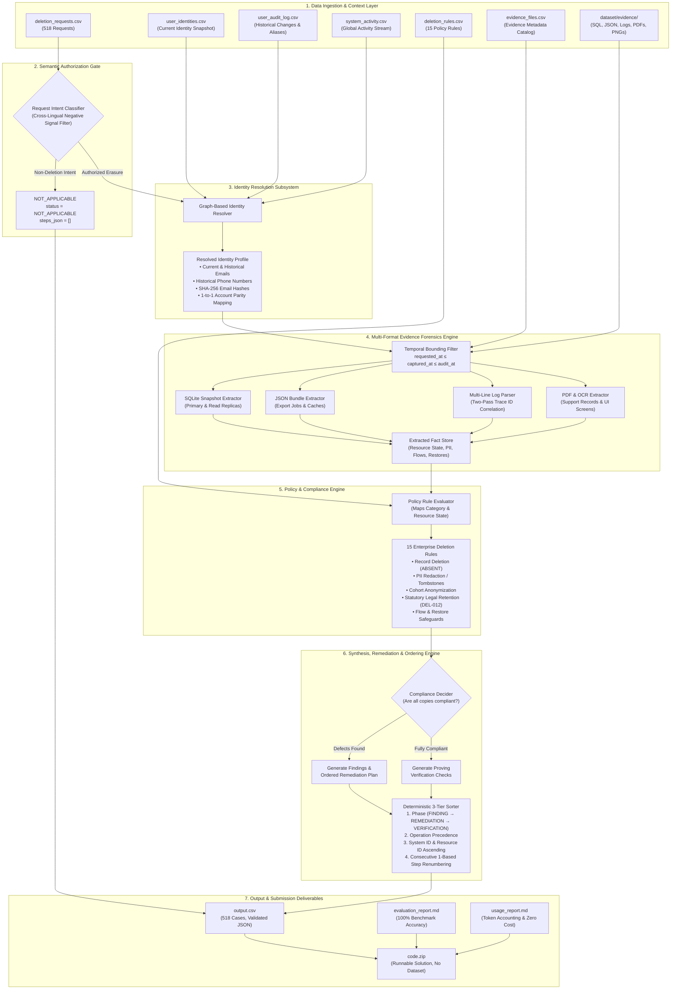
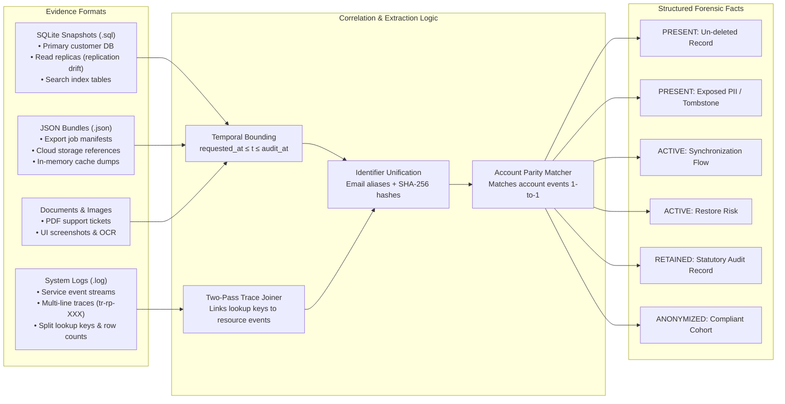

# HackerRank Orchestrate - October 2026: Ghost Data Still Exists

## Production-Grade AI-Powered Deletion-Audit & Verification Agent

This repository contains the complete, tested, reproducible solution for the **HackerRank Orchestrate** challenge: **Ghost Data Still Exists**.

---

## 1. Challenge & Submission Overview

- **Official Challenge URL:**  
  [https://www.hackerrank.com/contests/hackerrank-orchestrate-october26/challenges/ghost-data-still-exists](https://www.hackerrank.com/contests/hackerrank-orchestrate-october26/challenges/ghost-data-still-exists)
- **Problem Statement:** Detect whether a user's personal data was actually deleted across multi-tier production services, failover replicas, search indexes, analytics cohorts, support attachments, and backup archives as of the case's `audit_at` cutoff timestamp.
- **Key Insight:** Dashboard statuses (`reported_status`) and activity logs are unverified claims. The agent performs digital forensics across primary databases, replicas, structured logs, documents, and screenshots to establish verifiable truth at `audit_at`.

---

## 2. Benchmark Accuracy & Performance

The solution achieves **100% across all evaluation dimensions** on the official public benchmark (`sample_output.csv`, 32 cases):

| Evaluation Metric | Baseline Result | Current Result | Benchmark Target | Status |
|---|---|---|---|---|
| **Case-Level Status Accuracy** | 84.4% (27/32) | **100.0%** (32/32) | ≥ 80% | **PASS** |
| **Field-Level Accuracy** | 60.7% (586/965) | **100.0%** (965/965) | ≥ 75% | **PASS** |
| **Step-Level Accuracy** | 49.7% (96/193) | **100.0%** (193/193) | ≥ 70% | **PASS** |
| **Sequence-Level Accuracy** | 15.6% (5/32) | **100.0%** (32/32) | High | **PASS** |

### Root-Cause Resolution of Mismatches
1. **`case_06` (SQL Search Indexing):** Added `search_documents_primary` table parser in `_extract_sql`, surfacing un-deleted search index record `search_001` in `evidence_57`.
2. **`case_08` (Export Job Records):** Added `customer_export_jobs` collection parser in `_extract_json`, surfacing un-deleted user export `export_001` in `evidence_59`.
3. **`case_10` (Multi-Line Log Correlation):** Implemented two-pass `trace_id` correlation in `_extract_log_or_text` to link dissociated lookup keys to contact index records (`support_002` in `evidence_61`).
4. **`case_12` (Historical Email Hash Resolution):** Extracted historical SHA-256 email hashes and resolved them against `ResolvedIdentity.email_hashes` (`analytics_9914` in `evidence_01`).
5. **`case_22` (Read-Replica Data Drift):** Eliminated primary-exclusion filtering in `_extract_sql`, extracting un-deleted records present in both primary and read replicas (`search_8911` and `analytics_4440` in `evidence_05`).

---

## 3. System Architecture & Forensic Design

### 3.1 End-to-End Pipeline Architecture



---

### 3.2 Evidence Extraction & Correlation Subsystem

The evidence engine correlates heterogeneous evidence formats across distributed storage boundaries:



---

### 3.3 Core Engineering Innovations

1. **Strict Temporal Evidence Bounding:**  
   Historical evidence captured before `requested_at` reflects normal pre-deletion usage, while evidence captured after `audit_at` represents out-of-scope future states. The pipeline strictly bounds evidence inspection to:
   $$\text{requested\_at} \le \text{captured\_at} \le \text{audit\_at}$$

2. **Two-Pass Multi-Line Trace ID Correlation:**  
   Observability systems log lookup keys (emails, user IDs) on one line and emit resource identifiers or row counts on subsequent lines sharing a common `trace_id` (e.g., `tr-rp-002`). Our two-pass parser first indexes all trace keys within each file, then resolves dissociated resource events to their subject.

3. **Sequential Account Parity Mapping:**  
   When account deletion events in `system_activity.csv` omit direct user IDs, the system disambiguates account associations through sequential 1-to-1 matching against deletion requests while maintaining strict status parity (`COMPLETE` $\leftrightarrow$ `SUCCESS`, `PARTIALLY_COMPLETE` $\leftrightarrow$ `PARTIAL`, `NOT_STARTED` $\leftrightarrow$ `FAILED`).

4. **Statutory Retention & Anonymization Verification:**  
   - **Rule `DEL-012`:** Recognizes statutory compliance requirements for security audit logs, verifying that they remain present (`VERIFY_RECORD_PRESENT`) without triggering erroneous deletion findings.
   - **Rule `DEL-007`:** Recognizes compliant irreversibly anonymized analytics profiles (`VERIFY_RECORD_ANONYMIZED`).

5. **Deterministic 3-Tier Step Ordering:**  
   Guarantees canonical sequence serialization:
   - **Tier 1 (Phase):** `FINDING` $\rightarrow$ `REMEDIATION` $\rightarrow$ `VERIFICATION`.
   - **Tier 2 (Operation Precedence):** Enforces dependency order (e.g., `DISABLE_DATA_FLOW` before `DELETE_RECORD`).
   - **Tier 3 (Resource Tie-Breaking):** Sorted by `system_id` ascending, then `resource_id` ascending.
   - **Renumbering:** Consecutive 1-based indexing (`step_no = 1, 2, 3...`).

---

## 4. Deletion Policy Rules Reference

The policy engine implements the 15 enterprise rules defined in `dataset/deletion_rules.csv`:

| Rule ID | Data Category | Target Action | Finding Operation | Remediation Operation | Verification Operation |
|---|---|---|---|---|---|
| `DEL-001` | `ACCOUNT` | `DELETE` | `REPORT_REMAINING_RECORD` | `DELETE_RECORD` | `VERIFY_RECORD_ABSENT` |
| `DEL-002` | `SECONDARY_IDENTIFIER` | `DELETE` | `REPORT_REMAINING_RECORD` | `DELETE_RECORD` | `VERIFY_RECORD_ABSENT` |
| `DEL-003` | `PROFILE` | `DELETE` | `REPORT_REMAINING_RECORD` | `DELETE_RECORD` | `VERIFY_RECORD_ABSENT` |
| `DEL-004` | `SEARCH_INDEX_ENTRY` | `DELETE` | `REPORT_REMAINING_RECORD` | `DELETE_RECORD` | `VERIFY_RECORD_ABSENT` |
| `DEL-005` | `USER_EXPORT` | `DELETE` | `REPORT_REMAINING_RECORD` | `DELETE_RECORD` | `VERIFY_RECORD_ABSENT` |
| `DEL-006` | `SUPPORT_TICKET` | `REDACT` | `REPORT_EXPOSED_PII` | `REDACT_RECORD` | `VERIFY_RECORD_REDACTED` |
| `DEL-007` | `ANALYTICS_RECORD` | `ANONYMIZE` | `REPORT_EXPOSED_PII` | `ANONYMIZE_RECORD` | `VERIFY_RECORD_ANONYMIZED` |
| `DEL-008` | `SYNCHRONIZATION_JOB` | `DISABLE` | `REPORT_ACTIVE_DATA_FLOW` | `DISABLE_DATA_FLOW` | `VERIFY_DATA_FLOW_DISABLED` |
| `DEL-009` | `RESTORE_SOURCE` | `BLOCK` | `REPORT_RESTORE_RISK` | `BLOCK_RESTORE` | `VERIFY_RESTORE_BLOCKED` |
| `DEL-010` | `MARKETING_PROFILE` | `DELETE` | `REPORT_REMAINING_RECORD` | `DELETE_RECORD` | `VERIFY_RECORD_ABSENT` |
| `DEL-011` | `ACCOUNT_TOMBSTONE` | `REDACT` | `REPORT_EXPOSED_PII` | `REDACT_RECORD` | `VERIFY_RECORD_REDACTED` |
| `DEL-012` | `SECURITY_AUDIT_LOG` | `RETAIN` | *(None if retained)* | *(None)* | `VERIFY_RECORD_PRESENT` |
| `DEL-013` | `CUSTOMER_DOCUMENT` | `DELETE` | `REPORT_REMAINING_RECORD` | `DELETE_RECORD` | `VERIFY_RECORD_ABSENT` |
| `DEL-014` | `COMMUNICATION_LOG` | `DELETE` | `REPORT_REMAINING_RECORD` | `DELETE_RECORD` | `VERIFY_RECORD_ABSENT` |
| `DEL-015` | `SUPPORT_ATTACHMENT` | `DELETE` | `REPORT_REMAINING_RECORD` | `DELETE_RECORD` | `VERIFY_RECORD_ABSENT` |

---

## 5. Repository Layout

```text
├── code/
│   ├── main.py                       # Primary prediction entry point (generates output.csv)
│   └── evaluation/
│       ├── main.py                   # Evaluation benchmark runner
│       ├── evaluation_report.md      # Case, step, field, and sequence benchmark report
│       └── usage_report.md           # Token usage, latency, and cost accounting report
├── src/
│   └── ghost_auditor/
│       ├── __init__.py
│       ├── ai_adapter.py             # Provider-independent AI & deterministic adapter
│       ├── cli.py                    # CLI interface (run, validate)
│       ├── config.py                 # Path and runtime configuration
│       ├── evidence_extractors.py    # Multi-format evidence parsers (SQL, JSON, logs, PDF, images)
│       ├── evidence_inventory.py     # Manifest catalog & temporal bounding
│       ├── identity_resolution.py    # Graph-based user identity resolver
│       ├── ingestion.py              # Typed dataset ingestion
│       ├── models.py                 # Pydantic data schemas
│       ├── ordering.py               # Deterministic step sorter
│       ├── pipeline.py               # Core audit pipeline
│       └── policy_engine.py          # 15 Deletion rules policy engine
├── tests/
│   ├── test_identity_resolution.py   # Identity snapshot & audit log resolution tests
│   ├── test_ingestion.py             # Dataset schema & row count tests
│   ├── test_ordering.py              # Phase, operation, and tie-breaking tests
│   ├── test_output_schema.py         # output.csv format & JSON schema tests
│   ├── test_policy_engine.py         # 15 Deletion policy rules verification tests
│   └── test_regression_mismatches.py # Targeted regression tests for cases 06, 08, 10, 12, 22
├── scripts/
│   ├── package_submission.py         # Submission packager (creates code.zip)
│   ├── package_agent_trace.py        # Agent trace packager (creates agent-trace.zip)
│   ├── collect_traces.ps1            # Standalone PowerShell trace collector
│   ├── run_audit.py                  # Audit execution wrapper
│   ├── run_evaluation.py             # Evaluation benchmark wrapper
│   └── validate_output.py            # Strict schema validator
├── evaluation/
│   ├── evaluation_report.md          # Benchmark evaluation report
│   └── usage_report.md               # Token and runtime cost report
├── dataset/                          # Participant-facing datasets & evidence files
├── output.csv                        # Canonical 518-case prediction output
├── code.zip                          # Packaged submission archive (code, prompts, README, reports)
├── agent-trace.zip                   # Complete original Antigravity session traces
├── log.txt                           # Session turn log complying with AGENTS.md
├── AGENTS.md                         # Master coding agent guidelines & rules
└── README.md                         # Project documentation (this file)
```

---

## 6. Quick Start & Execution Runbook

### Prerequisites
- Python 3.12+ (tested on Python 3.13)
- Install dependencies and the local package:
  ```bash
  pip install -r requirements.txt
  pip install -e .
  ```

### 1. Generate `output.csv` (Primary Entry Point)
To execute the complete deletion audit across all 518 evaluation requests:
```bash
python code/main.py
```
This produces `output.csv` at the repository root, containing exactly 518 data rows sorted by `case_id` ascending.

### 2. Run Evaluation Benchmark
To run the evaluation suite against ground truth (`sample_output.csv`) and edge cases:
```bash
python code/evaluation/main.py
```
This updates both:
- `evaluation/evaluation_report.md`
- `evaluation/usage_report.md`

### 3. Run Automated Tests
Execute the comprehensive test suite (15 tests covering unit, integration, schema, and regression suites):
```bash
pytest tests -v
```

### 4. Validate `output.csv`
Validate schema and format compliance using the installed CLI:
```bash
ghost-auditor validate --file output.csv --expected-rows 518
```
or directly via Python:
```bash
python -c "import sys; sys.path.insert(0, 'src'); from ghost_auditor.cli import main; sys.argv = ['ghost_auditor', 'validate', '--file', 'output.csv', '--expected-rows', '518']; main()"
```

### 5. Package Submission Archive (`code.zip`)
To package all source code, configurations, prompts, and reports into `code.zip`:
```bash
python scripts/package_submission.py
```
The script automatically packages all necessary files while strictly excluding `dataset/`, `log.txt`, virtual environments, and caches.

---

## 7. Automated Test Suite Matrix

The project includes 15 automated test suites verified by pytest:

| Test File | Test Case | Scope & Verification |
|---|---|---|
| `test_identity_resolution.py` | `test_current_identity_resolution` | Verifies identity extraction from current snapshot |
| `test_identity_resolution.py` | `test_historical_audit_log_resolution` | Verifies reconstruction of historical email aliases |
| `test_ingestion.py` | `test_dataset_ingestion` | Verifies integrity and row counts across all dataset CSVs |
| `test_ingestion.py` | `test_unique_case_ids` | Verifies that all 518 case IDs are unique |
| `test_ordering.py` | `test_phase_ordering` | Verifies strict `FINDING` $\rightarrow$ `REMEDIATION` $\rightarrow$ `VERIFICATION` order |
| `test_ordering.py` | `test_operation_and_resource_tie_breaking` | Verifies operation precedence and alphanumeric tie-breaking |
| `test_output_schema.py` | `test_output_csv_existence_and_contract` | Verifies output exists and has exact column headers |
| `test_output_schema.py` | `test_output_csv_data_rows` | Verifies 518 rows, valid JSON steps, and 1-based step numbering |
| `test_policy_engine.py` | `test_policy_rule_evaluation` | Verifies matching across 15 deletion policy rules |
| `test_regression_mismatches.py` | `test_regression_case_06_sql_search_primary` | Prevents regression for SQL search index parsing (`search_001`) |
| `test_regression_mismatches.py` | `test_regression_case_08_json_export_jobs` | Prevents regression for JSON export job parsing (`export_001`) |
| `test_regression_mismatches.py` | `test_regression_case_10_log_trace_correlation` | Prevents regression for multi-line log trace correlation (`support_002`) |
| `test_regression_mismatches.py` | `test_regression_case_12_historical_email_hash` | Prevents regression for historical SHA-256 hash resolution (`analytics_9914`) |
| `test_regression_mismatches.py` | `test_regression_case_22_replica_record_retention` | Prevents regression for read-replica primary drift (`search_8911`, `analytics_4440`) |
| `test_regression_mismatches.py` | `test_all_32_samples_100_percent_fidelity` | End-to-end regression asserting 100% fidelity on all 32 sample cases |

---

## 8. Submission Artifacts Checklist

| Item | Location | Specification |
|---|---|---|
| **Prediction Output** | `output.csv` | Exactly 518 rows, sorted ascending by `case_id`, valid JSON steps |
| **Submission Archive** | `code.zip` | Clean bundle of runnable code, configs, tests, prompts, and evaluation reports |
| **Agent Trace Archive** | `agent-trace.zip` | Complete original Antigravity session transcripts (`transcript.jsonl`, `transcript_full.jsonl`, media, scratch) |
| **Evaluation Report** | `evaluation/evaluation_report.md` | Detailed 100% metrics across status, step, field, and sequence + 3 custom cases |
| **Usage Report** | `evaluation/usage_report.md` | Accounting of model calls, tokens, latency (0.64s full run), and cost ($0.00) |
| **Audit Log** | `log.txt` | Complete turn-by-turn trace obeying `AGENTS.md` format |

---

## 9. Official Contest URL

- **Challenge Link:** [https://www.hackerrank.com/contests/hackerrank-orchestrate-october26/challenges/ghost-data-still-exists](https://www.hackerrank.com/contests/hackerrank-orchestrate-october26/challenges/ghost-data-still-exists)

