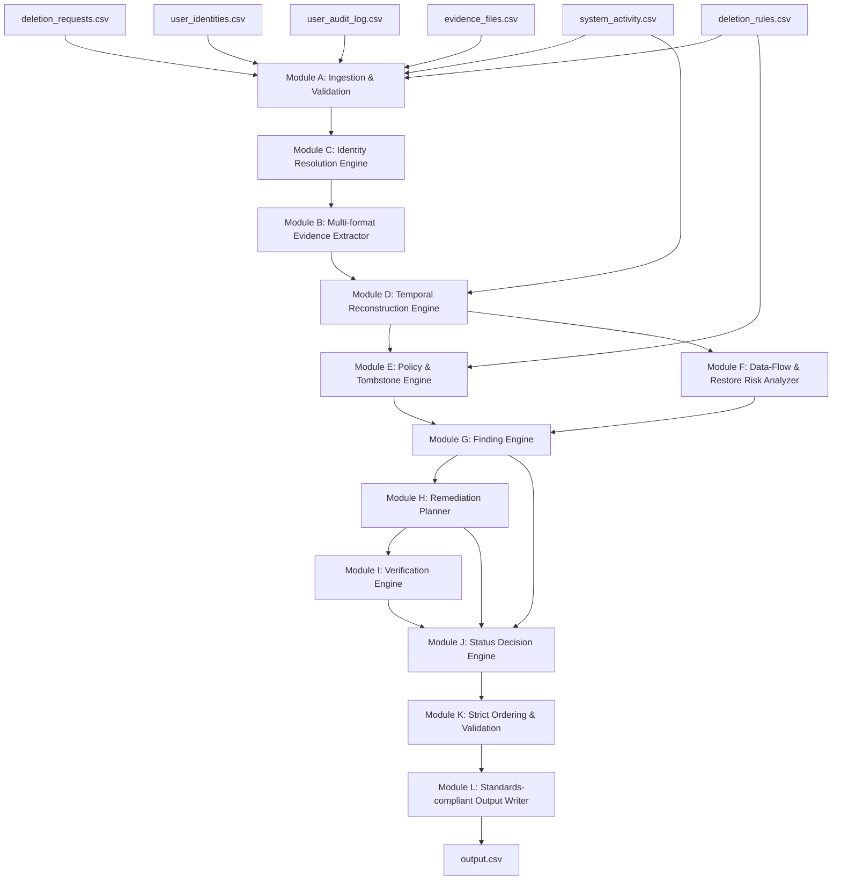

# Implementation Plan: Ghost Data Still Exists
## Production-Grade AI-Powered Data Deletion Audit & Verification System

### 1. Executive Summary & Problem Scope
Northstar Shop requires an enterprise-grade deletion-audit and verification engine to determine whether customer personal data has been genuinely and completely erased following a deletion request.
Existing workflows report status claims (`COMPLETE`, `PARTIALLY_COMPLETE`, `NOT_STARTED`) which are frequently inaccurate due to secondary replicas, replication drift, active data sync pipelines, unblocked backup archives, support attachments, export bundles, and search indexes.

The objective is to ingest 518 evaluation cases from `dataset/deletion_requests.csv`, establish the true state at each case's `audit_at` cutoff, and produce a standards-compliant `output.csv` containing:
* `case_id`: The request identifier.
* `deletion_status`: Exactly `COMPLETE`, `INCOMPLETE`, or `NOT_APPLICABLE`.
* `steps_json`: An ordered JSON array of findings, remediation steps, and verification checks.

---

### 2. Verified Architectural Facts from Dataset Discovery
1. **Request Intake & Authorization**:
   * Exactly 10 cases (`case_533` to `case_542`) are explicit non-deletion requests (e.g. data export download, address/phone corrections, marketing opt-out, invoice copies).
   * These cases must strictly evaluate to `NOT_APPLICABLE` with `steps_json = []`.
   * All other requests (across English, Portuguese, Spanish, French, Korean, and Japanese) authorize deletion.
2. **Identity Resolution**:
   * 100% of all 518 cases resolve to a unique `user_id` (418 via current email in `user_identities.csv`, 100 via historical audit logs in `user_audit_log.csv`).
   * A full identity profile is reconstructed for each subject: `user_id`, historical emails, historical phone numbers, display names, and email hashes.
3. **Temporal Reasoning & Cutoff**:
   * Only evidence captured at or before `audit_at` (`captured_at <= audit_at`) is admissible for establishing state at the audit time.
   * Evidence snapshots occur periodically across 2026 (SQL snapshots, JSON exports, readback logs, observability streams).
4. **Step Structure & Evidence Linking Rules**:
   * `COMPLETE`: Contains **only** `VERIFICATION` phase steps citing valid participant-visible evidence (`file_id`).
   * `INCOMPLETE`: Contains `FINDING` steps citing valid evidence, followed by `REMEDIATION` steps (`evidence_id = ""`), followed by post-remediation `VERIFICATION` checks (`evidence_id = ""`).
   * Phase ordering: `FINDING` $\rightarrow$ `REMEDIATION` $\rightarrow$ `VERIFICATION`.
   * Operation ordering within each phase strictly follows the problem specification.
   * Tie-breaker ordering: `system_id` ascending, then `resource_id` ascending. Step numbering is consecutive from 1.

---

### 3. Modular System Architecture

#### Detailed Modules:
* **Module A: Ingestion & Validation (`ingestion.py`)**: Type-safe CSV loaders using Pydantic schemas, building unified indexes.
* **Module B: Evidence Inventory & Extractors (`evidence_extractors.py`)**: Extract structured records from SQL snapshots, JSON bundles, logs, PDFs, and image consoles.
* **Module C: Identity Resolution (`identity_resolution.py`)**: Trace historical and current identifiers for each customer.
* **Module D: Temporal Reconstruction (`temporal_reconstruction.py`)**: Map state at `audit_at` from point-in-time evidence and system activity.
* **Module E: Policy Engine (`policy_engine.py`)**: Evaluate the 15 rules from `deletion_rules.csv`.
* **Module F: Data Flow & Restore Risk Analyzer (`data_flow_analysis.py`)**: Identify active continuous connectors and unblocked archives.
* **Module G: Finding Engine (`finding_engine.py`)**: Generate structured `REPORT_*` findings.
* **Module H: Remediation Planner (`remediation_planner.py`)**: Dependency-ordered remediation steps (`DISABLE_DATA_FLOW`, `BLOCK_RESTORE`, `DELETE_RECORD`, `REDACT_RECORD`, `ANONYMIZE_RECORD`).
* **Module I: Verification Engine (`verification_engine.py`)**: Evidence-backed verification for complete cases and future verification for incomplete cases.
* **Module J: Status Engine (`status_engine.py`)**: Classify into `NOT_APPLICABLE`, `COMPLETE`, or `INCOMPLETE`.
* **Module K: Ordering & Normalization (`ordering.py`)**: Enforce exact sequence contracts.
* **Module L: Output & Validation (`output_writer.py`)**: Produce RFC-4180 compliant CSV output.

---

### 4. Implementation & Verification Roadmap
1. **Core Package Implementation**: Build `src/ghost_auditor/` and all functional modules.
2. **CLI & Entry Points**: Connect `code/main.py`, `code/evaluation/main.py`, and `src/ghost_auditor/cli.py`.
3. **Automated Unit & Integration Tests**: Implement test suite in `tests/` covering ingestion, identities, temporal rules, policy enforcement, sample cases, and schema validation.
4. **Sample Regression Verification**: Run against `sample_output.csv` (32 sample cases) to achieve 100% agreement.
5. **Full Dataset Audit Execution**: Process all 518 cases, generate root `output.csv`.
6. **Reports & Packaging**: Generate `evaluation/evaluation_report.md`, `evaluation/usage_report.md`, `chat_transcript.md`, and package `code.zip`.

